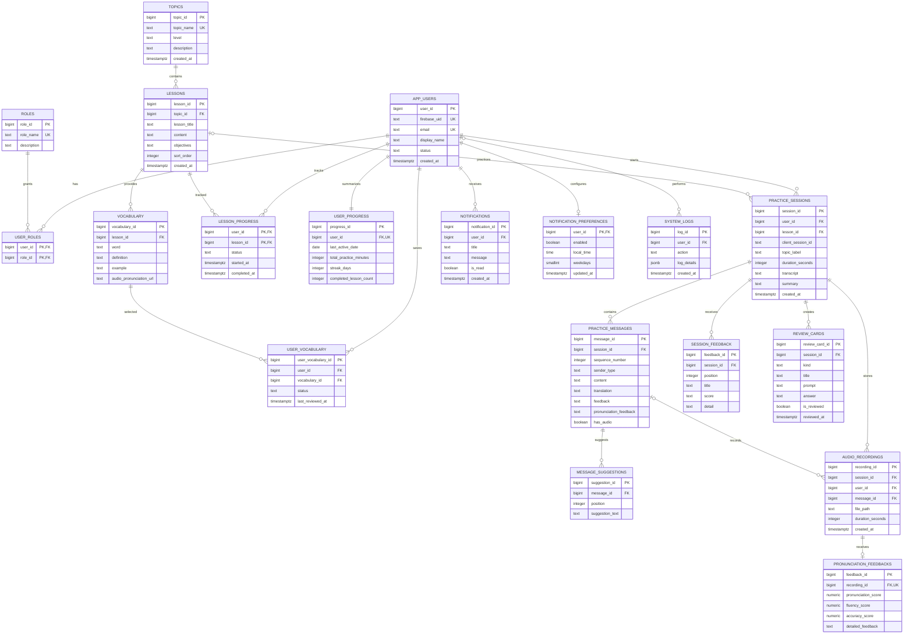

# ERD đầy đủ cho ElevateEnglish

Sơ đồ dưới đây theo schema PostgreSQL đang triển khai trong `backend/sql/postgres_schema.sql`. Firebase tiếp tục quản lý xác thực; PostgreSQL lưu danh tính ứng dụng, nội dung học và dữ liệu tiến độ.

## Luồng tính năng

- Quản trị viên tạo chủ đề, bài học và từ vựng qua màn hình Quản trị. Người học luyện theo bài, đánh dấu hoàn thành và xem tiến độ tích lũy.
- Mỗi phiên có các lượt người học/trợ lý, gợi ý trả lời, phản hồi cuối buổi và thẻ ôn tập.
- Audio được lưu vào thư mục cấu hình `AUDIO_STORAGE_DIR`; database chỉ giữ đường dẫn và metadata. Khi triển khai, thư mục cần nằm trên volume bền vững hoặc được thay bằng object storage.
- Từ/cụm từ người học lưu được gắn vào `USER_VOCABULARY`. Tiến độ học bài nằm trong `LESSON_PROGRESS`; `USER_PROGRESS` giữ phần tổng hợp.
- Công tắc nhắc học đặt thông báo cục bộ trên thiết bị và đồng bộ lịch với `NOTIFICATION_PREFERENCES`. Bảng `NOTIFICATIONS` ghi các sự kiện như hoàn thành bài học; remote push chưa được cấu hình.
- Các bảng học tập yêu cầu đăng nhập. Firebase UID ánh xạ sang `APP_USERS`; không lưu mật khẩu Firebase trong PostgreSQL.

Áp dụng schema và seed dữ liệu mẫu theo hướng dẫn trong [`backend/README.md`](../backend/README.md).
